# NGO Donation Transparency Tracker

A blockchain-based dApp that lets NGOs record donations and expenditures on an immutable public ledger,
so donors can verify exactly how their contribution was used.

**Subject:** Blockchain (CSDC7022), Mini Project, Sem VII

---

## Problem Statement

India has one of the largest non-profit sectors in the world, with an estimated **3.3 million registered NGOs**,
roughly one NGO for every 400 people. Oversight has not kept pace with this scale: **fewer than 10%** of
registered NGOs file their annual financial returns, and only around 17,000–35,000 organizations hold a valid
FCRA license, so the vast majority operate with little to no independent financial audit.

This gap directly affects donor behaviour. Bain & Company's India Philanthropy Report found that **50% of
surveyed donors could not identify an NGO they considered credible enough to donate to**. Uncertainty about
whether the money will actually reach the cause is the most common reason first-time donors hesitate to give.
Donors depend almost entirely on self-reported, non-verifiable statements from the NGO, typically a PDF report
released months after funds are collected.

This is especially harmful for smaller or newer NGOs and for sudden disaster-relief collections (floods,
cyclones), which need to earn donor trust quickly but have no track record or audit history.

## Solution

The project replaces the NGO's self-reported PDF report with a **smart contract** that both accepts donations
and permanently logs how the funds are spent. No party, including the NGO itself, can alter records after the fact.

- An NGO (or an individual raising money for a personal cause) creates a **cause** on-chain with a title, description,
  category, funding goal and deadline.
- Donors send ETH directly to the smart contract. Each donation is recorded permanently against the donor's wallet address.
  Once the goal is reached, **donations close** (the donation that crosses the goal is accepted in full).
- The NGO spends the funds through an **automatic audit**: every payment needs a **receipt PDF** whose amount and supplier
  wallet match the payment, a receipt can never be used twice, and the NGO can never pay itself. If every check passes, the
  contract pays the supplier directly and records the payment with the receipt's SHA-256 fingerprint.
- If the cause misses its goal by the deadline, donors can **claim a refund** of exactly what they gave.
- Anyone can view the **total raised**, the **itemized expenditure trail** with receipt proofs, the **remaining balance**,
  and a live **activity table** of every on-chain event.

Trust becomes something donors can independently verify, not something the NGO has to ask for.

## Features

| Feature | What it does | Blockchain concept |
|---|---|---|
| Causes and donations | NGOs create causes; donors send ETH, recorded per wallet; donations close once the goal is reached | Payable functions, public ledger |
| **Automatic audit of spending** | Every payment is checked before money moves (see below); the supplier is paid directly by the contract | Rules enforced by code, access control, checks-effects-interactions |
| **Compulsory receipts** | A receipt PDF is required; its SHA-256 fingerprint is stored on-chain and can never be reused. Anyone can re-check a file against it | Hashing, tamper-evidence, off-chain storage with on-chain verification |
| **Refunds** | Spending unlocks only once the goal is reached; if the deadline passes first, donors withdraw their own donation | Time-based conditions, pull-payment pattern (reentrancy-safe) |
| **Verified creators and categories** | After an off-chain document check, the owner records a cause creator as a *registered organisation* or an *individual* (personal causes such as medical treatment). The owner cannot create causes | Ownership pattern, role-based access control |
| **Activity table** | A live table (event, cause, from, to, amount, details, time, block) built from contract events | Events / logs as the dApp's sync mechanism |

### The automatic audit

| Check | Where it is enforced |
|---|---|
| Only the cause's NGO can spend | Contract (`onlyNGO`) |
| Goal reached before any spending | Contract |
| A receipt is attached | Contract (receipt hash cannot be empty) + website |
| The receipt has never been used before | Contract (`receiptUsed`) + website |
| Recipient is not the NGO itself or the platform owner | Contract + website |
| Amount is within the remaining balance | Contract + website |
| The receipt is a PDF whose **Total Amount** equals the amount entered | Website (reads the PDF with pdf.js) |
| The receipt's **Pay to wallet** equals the recipient entered | Website (reads the PDF with pdf.js) |

If any contract check fails, the whole transaction is rejected and nothing is paid. The two PDF checks run in the
browser because a smart contract cannot read files; the website keeps **Audit & Pay** locked until they pass.

### Extensions beyond the approved proposal

The proposal covered causes, donations, expenditure logging and public viewing. To address the weaknesses that an
NGO could pay itself, reuse one bill for several payments, or spend money of a cause that later failed, these were
added: the automatic audit with compulsory receipts, goal-based donations/spending and refunds, creator
verification with categories, and the event-based activity feed.

**Known limitations (worth stating in the viva):**
- A blockchain cannot see the physical world. The audit proves the payment matches an unaltered, never-reused receipt;
  it cannot prove the goods were delivered or that the receipt itself is genuine.
- The PDF checks (amount and wallet on the receipt) run in the website; someone calling the contract directly could skip
  them, but the on-chain checks (receipt required and unique, no self-payment, balance) still apply.
- Creator verification is only as trustworthy as the owner's off-chain document check.

## Tech Stack

| Part | Technology |
|---|---|
| Smart contract | Solidity 0.8.24 |
| Compile / test / deploy | Hardhat (local Hardhat Network) |
| Frontend | Plain HTML, CSS, JavaScript + ethers.js v6 |
| Receipt reading | pdf.js 3.11 (Mozilla), loaded from a CDN |
| Wallet | MetaMask |

> **Note on the proposal:** the proposal listed Remix IDE and Ganache. These were replaced by **Hardhat**,
> which provides both the local blockchain (`npx hardhat node`, the Ganache equivalent) and automated
> tests (the Remix equivalent) in one tool.

## Project Structure

```
├── contracts/NGODonationTracker.sol   # the smart contract
├── scripts/deploy.js                  # deploys from account #19 with #0 as owner, writes address + ABI for the frontend
├── scripts/make_demo_receipts.py      # generates the three demo receipt PDFs (skips existing ones)
├── test/NGODonationTracker.test.js    # Hardhat tests (26)
├── frontend/
│   ├── index.html
│   ├── app.js                         # ethers.js logic, automatic audit, activity feed
│   └── style.css
├── docs/demo-receipts/                # receipt1.pdf, receipt2.pdf (valid), receipt3.pdf (fake)
├── docs/screenshots/                  # app screenshots used in the report
├── docs/Blockchain_MPR_Report_Group4.docx  # project report
├── docs/Project_Explanation.pdf       # simple-English explanation
├── hardhat.config.js
└── package.json
```

## Smart Contract Overview

**Roles**

| Role | Who | Can do |
|---|---|---|
| Owner | account #0, set when the contract is deployed | verify cause creators (organisation / individual); cannot create causes |
| NGO | the account that created a cause | spend that cause's funds (each payment audited automatically) |
| Donor | anyone | donate; claim a refund if the cause misses its goal |
| Recipient | the supplier's wallet written on the receipt | receives payments; does nothing on the website |

**Structs:** `Cause` (id, ngo, title, description, category, goal, deadline, totalRaised, totalSpent, totalRefunded),
`Donation` (donor, amount, timestamp), `Expenditure` (description, amount, recipient, receiptHash, receiptURI, timestamp).

| Function | Who | Purpose |
|---|---|---|
| `setCreatorType(creator, type)` | owner | Record a creator as Organisation, Individual or Unverified (trust badge only) |
| `createCause(title, description, category, goal, deadline)` | anyone except the owner | Create a cause; the caller becomes its NGO |
| `donate(causeId)` *payable* | anyone | Donate ETH before the deadline and while the goal is not yet reached. Tracked per donor |
| `logExpenditure(causeId, description, amount, recipient, receiptHash, receiptURI)` | that cause's NGO | Runs the on-chain audit checks, pays the recipient and records the expenditure |
| `claimRefund(causeId)` | donor | After the deadline, if the goal was missed: returns the donor's total contribution |
| `getCause`, `getDonations`, `getExpenditures` | view | Cause details, donation history, expenditure trail |
| `getRemainingBalance`, `isRefundable`, `receiptUsed` | view | ETH still held; whether refunds are open; whether a receipt was already used |
| `owner`, `creatorType`, `contributions`, `causeCount` | view | Public state |

**Events:** `CreatorVerified`, `CauseCreated`, `DonationReceived`, `ExpenditureLogged`, `RefundClaimed`.

**Design choices**
- **Donations close at the goal.** The donation that reaches the goal is accepted in full (it may go over).
- **Spending waits for the goal.** A cause that misses its goal still holds every wei it received, so every refund
  is always fully payable.
- **Checks-effects-interactions / pull payments.** State is updated before any ETH is sent, and refunds are
  withdrawn by the donor (balance set to zero before the transfer), which blocks reentrancy attacks.
- Each cause tracks its own balance, so funds can never move between causes.

> **Why the contract is deployed by account #19:** MetaMask keeps its own transaction counter (nonce) for each
> account. If an account you use in MetaMask also sent transactions from a script, MetaMask's counter would fall
> behind and it would fail with "nonce has already been used". So the deploy script uses account #19 (never
> imported into MetaMask) and passes #0 in as the owner.

## How to Run Locally

**Prerequisites:** Node.js 18+, the MetaMask browser extension (in Chrome), and an internet connection (ethers.js
and pdf.js load from a CDN).

```bash
# 1. Install dependencies
npm install

# 2. Run the tests (26 passing)
npx hardhat test
```

Then use two terminals:

```bash
# Terminal 1: start the local blockchain (keep it running)
npm run node

# Terminal 2: deploy the contract, then serve the frontend
npm run deploy
npm run frontend
```

Open **http://127.0.0.1:8080** in Chrome.

### MetaMask setup (one time)

1. MetaMask → network menu → **Add a custom network**:
   - Network name: `Hardhat Local`
   - RPC URL: `http://127.0.0.1:8545`
   - Chain ID: `31337`
   - Currency symbol: `ETH`
2. Import these test accounts (account menu → Add account → Import account → paste the private key), then click
   **Connect** in MetaMask for each one so the site may use it:

| Role | Hardhat account | Address | Private key |
|---|---|---|---|
| Owner | #0 | `0xf39Fd6e51aad88F6F4ce6aB8827279cffFb92266` | `0xac0974bec39a17e36ba4a6b4d238ff944bacb478cbed5efcae784d7bf4f2ff80` |
| NGO | #1 | `0x70997970C51812dc3A010C7d01b50e0d17dc79C8` | `0x59c6995e998f97a5a0044966f0945389dc9e86dae88c7a8412f4603b6b78690d` |
| Donor | #3 | `0x90F79bf6EB2c4f870365E785982E1f101E93b906` | `0x7c852118294e51e653712a81e05800f419141751be58f605c371e15141b007a6` |
| Supplier 1 (receipt1.pdf) | #4 | `0x15d34AAf54267DB7D7c367839AAf71A00a2C6A65` | optional, to watch its balance |
| Supplier 2 (receipt2.pdf) | #5 | `0x9965507D1a55bcC2695C58ba16FB37d819B0A4dc` | optional, to watch its balance |

> These keys are publicly known. Never use them on a real network.

### Demo flow

The site has four tabs: **Causes**, **Create Cause**, **Activity** and **Admin** (only for the owner).
The demo receipts are in `docs/demo-receipts/`: **receipt1.pdf** (Sharma Traders, 5 ETH, pay to #4) and
**receipt2.pdf** (Gupta Tent House, 3 ETH, pay to #5), plus a fake **receipt3.pdf** that must be rejected.

1. **Owner verifies the NGO.** Connect as **Owner** → **Admin** tab → paste the NGO address (#1), choose
   **Registered organisation** (or **Individual** for a personal cause) → **Verify**.
2. **NGO creates a cause.** Connect as **NGO** → **Create Cause**: "Assam Flood Relief", goal `10`, a deadline next week.
3. **Donor donates.** Connect as **Donor** → donate `10` ETH. The cause shows *Goal reached · donations closed*.
4. **Automatic audit, failing.** Connect as **NGO**. In **Spend Funds (automatic audit)**:
   - type "50 rice bags", amount `5`, supplier `0x15d3…6A65`: the checklist shows *Receipt PDF attached* in red and
     **Audit & Pay** stays locked;
   - attach **receipt1.pdf** and change the amount to `8`: *Amount on receipt (5 ETH) matches…* turns red.
5. **Automatic audit, passing.** Change the amount back to `5`: every check is green, **Audit & Pay** unlocks. Click it
   and confirm in MetaMask: 5 ETH goes straight to Sharma Traders (#4). Spent 5, Remaining 5.
6. **Reused receipt is blocked.** Attach **receipt1.pdf** again: *This receipt has already been used* (checked on-chain).
7. **Fake receipt is blocked.** Attach **receipt3.pdf**: it is a tampered copy of receipt1 whose wallet was changed
   to the NGO's own (`0x7099…79C8`). Whatever is entered, a check stays red ("Recipient is not the NGO itself" or
   "Recipient on receipt matches…") and **Audit & Pay** stays locked; the contract would also reject it.
8. **Second supplier.** Attach **receipt2.pdf**: amount `3` and wallet `0x9965…A4dc` fill in automatically, every check
   passes, pay: 3 ETH goes to Gupta Tent House (#5). Spent 8, Remaining 2.
9. **Anyone verifies.** Click **View donations & expenditures** → each payment shows *Passed & paid* and its receipt
   fingerprint; **Verify** + pick receipt1.pdf → "Receipt verified".
10. **Activity tab:** every step with block numbers, e.g. *"Automatic audit passed: 5.0 ETH paid to 0x15d3…"*.

**Refund demo (takes ~2 minutes):** as NGO, create a second cause with a goal of `10` and a deadline 2 minutes
from now. As Donor, donate `1`. Wait until the deadline passes, then refresh the page (F5) and reconnect as Donor:
the cause shows *Goal missed · refunds open* and a **Claim refund** button that returns the 1 ETH.

**Making your own receipt:** any PDF works if it contains the lines `Total Amount: <number> ETH` and
`Pay to wallet: <0x address>` (see `scripts/make_demo_receipts.py`).

### Things to try that should fail

| Try | Result |
|---|---|
| Spending without a receipt, or with a non-PDF file | Audit & Pay stays locked; the contract also rejects an empty receipt |
| Amount or supplier different from the receipt | The matching check turns red; payment locked |
| Reusing a receipt | "This receipt has already been used" (also rejected by the contract) |
| Paying the NGO's own wallet or the owner | Red check; the contract rejects it |
| Spending before the goal is reached | The form is replaced by "Spending unlocks once the goal … is reached" |
| Donating after the goal is reached | No Donate box; the contract also rejects it |
| Owner creating a cause | "The platform owner cannot create causes" |
| Claiming a refund twice | "Nothing to refund" |

### Troubleshooting

- **"nonce has already been used" / "nonce too high", or transactions stuck, after restarting `npm run node`:** MetaMask
  remembers the old chain's transaction count. Go to MetaMask → Settings → Advanced → **Clear activity tab data**, then
  run `npm run deploy` again.
- **The site shows a different account than MetaMask:** click **Connect** in MetaMask for that account (each imported
  account must be connected to the site once), then refresh.
- **"Could not read the PDF":** pdf.js loads from the internet; check the connection and refresh.
- **"Could not load causes":** make sure `npm run node` is running and you ran `npm run deploy` after starting it.
- **Causes disappeared:** restarting `npm run node` starts a fresh, empty blockchain. Redeploy and recreate them.

## Screenshots

Taken from the running app on the local Hardhat network (also used in the report, `docs/Blockchain_MPR_Report_Group4.docx`).

**1. Hardhat test accounts imported into MetaMask, one per role**

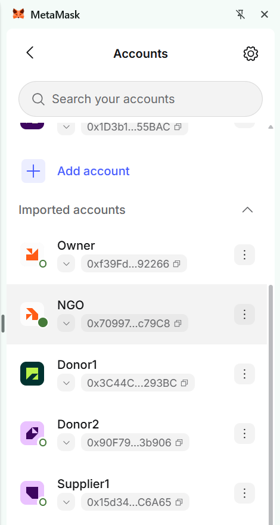

**2. Admin panel: owner verifies the NGO as a registered organisation**

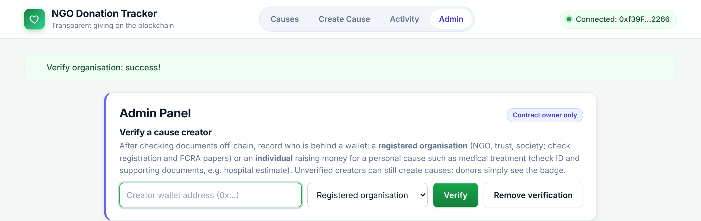

**3. Creating a cause**

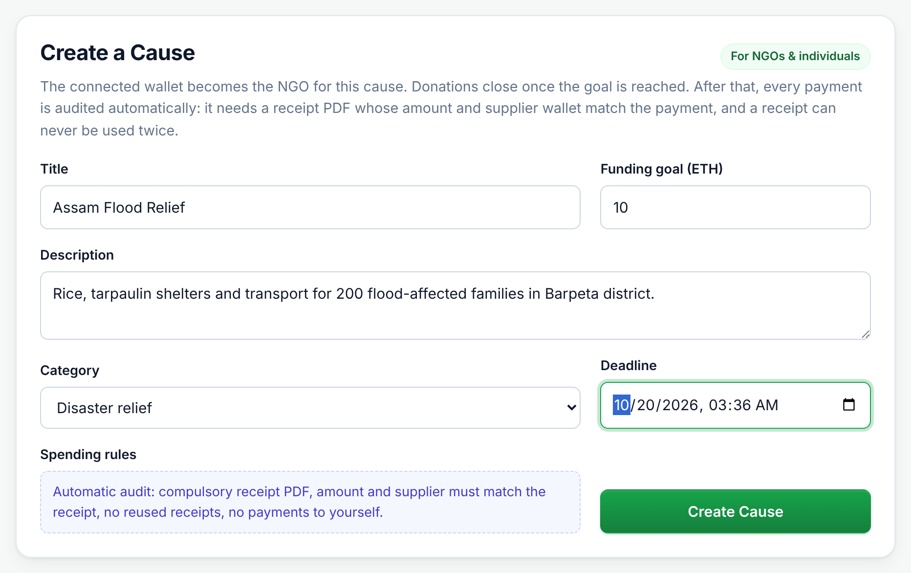

**4. A donation reaches the goal: donations close, spending opens**

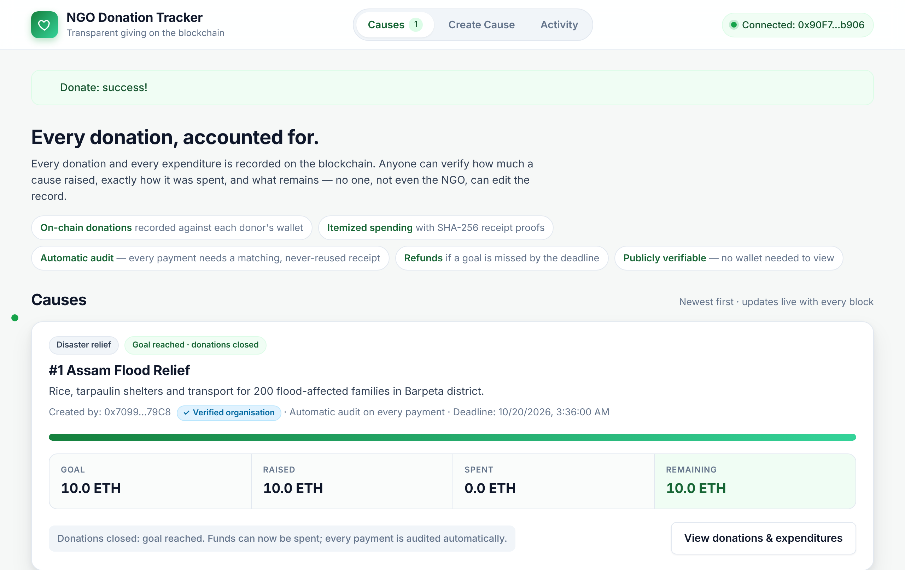

**5. Automatic audit with a failed check (amount does not match the receipt); payment locked**

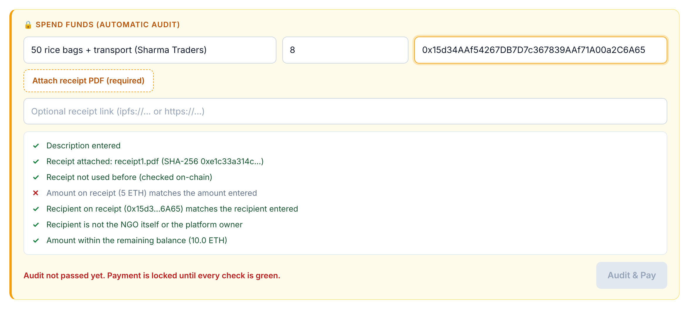

**6. receipt1.pdf: all checks green, Audit & Pay unlocked**

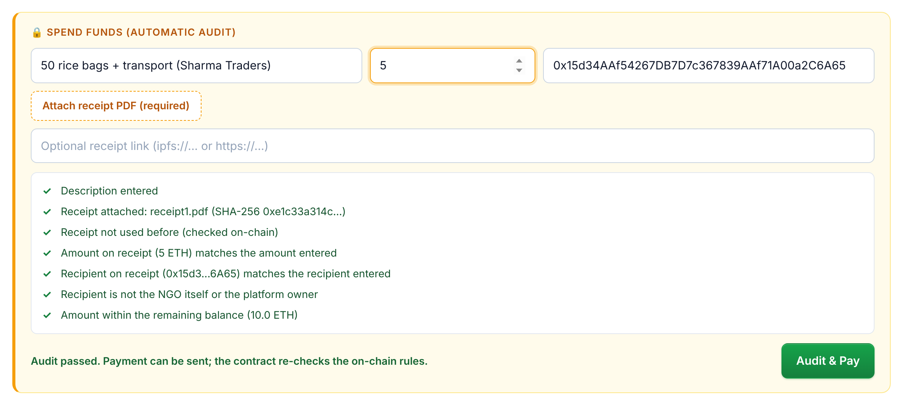

**7. Fake receipt3.pdf (pays the NGO itself) rejected**

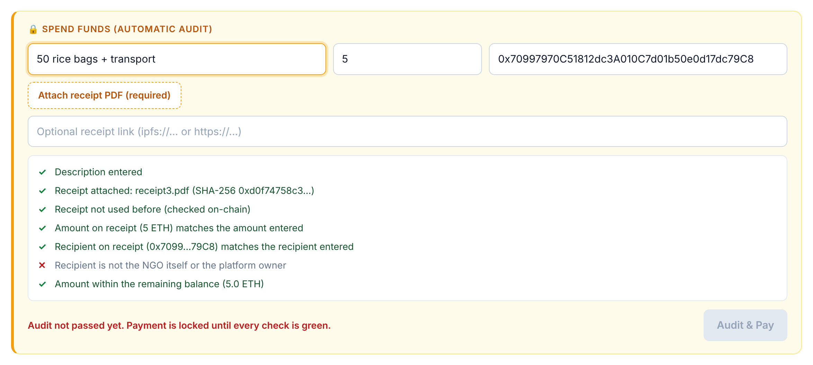

**8. Cause card after both payments: 10 raised, 8 spent, 2 remaining**

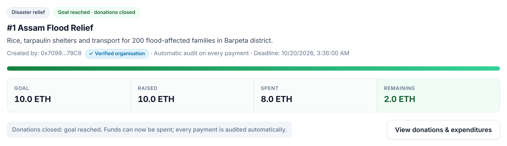

**9. Donations and expenditures with receipt fingerprints and Verify links**

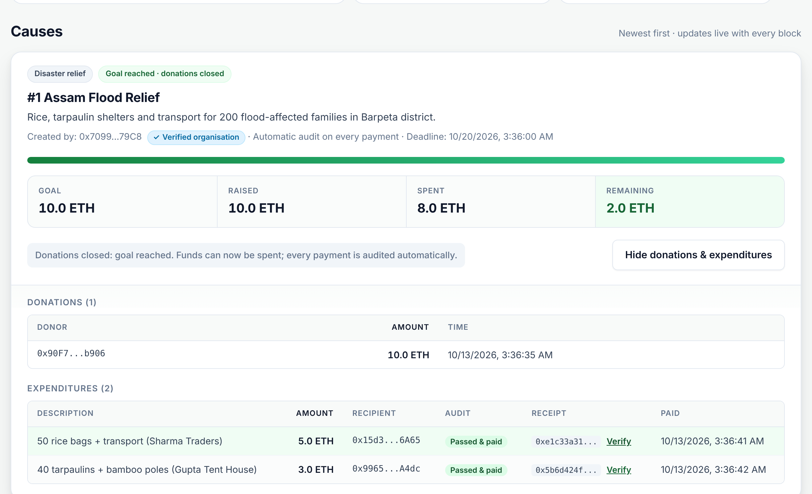

**10. Activity tab built from contract events**

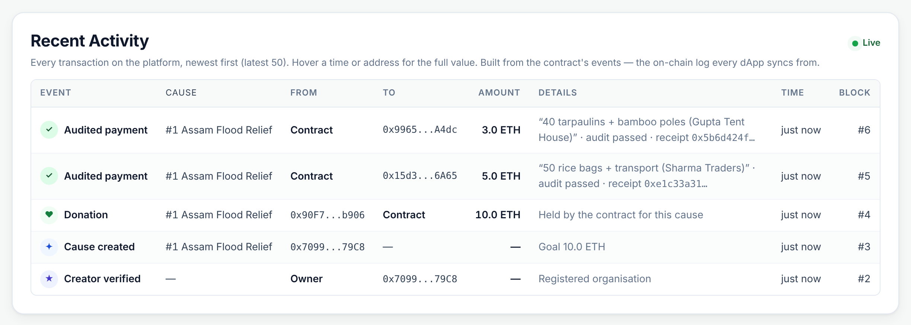

**11. `npx hardhat test`: 26 passing**

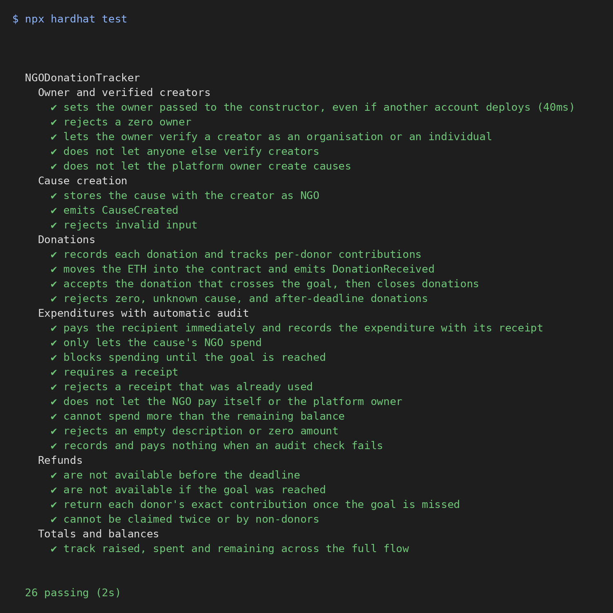

## Concepts Demonstrated

- Smart contracts, transactions and payable functions
- Access control with modifiers (`onlyOwner`, `onlyNGO`)
- Rule-based automatic auditing enforced by contract code
- Hashing (SHA-256) for tamper-evident, single-use receipts, with optional off-chain storage (IPFS)
- Time-based logic and the pull-payment pattern for refunds (reentrancy protection)
- Events as an auditable, indexable activity log
- Public ledger auditability and immutability
- Wallet-based identity and roles
- Centralized (PDF reports) vs. decentralized (on-chain) record-keeping
